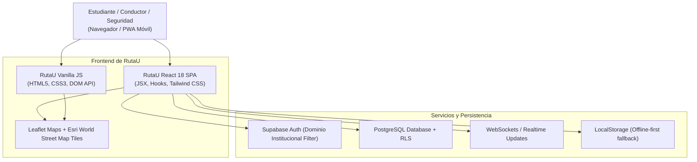

# 🏗️ Arquitectura del Sistema - RutaU

## 🌐 Visión Arquitectónica General

---

## 🔒 Modelo de Seguridad y Privacidad
1. **Acceso Cerrado:** Filtro estricto de dominio institucional (`@pascualbravo.edu.co` / `@*.edu.co`).
2. **Políticas RLS en Base de Datos:** Los pasajeros únicamente pueden modificar sus propias reservas y los conductores sus propios trayectos.
3. **Módulo SOS:** Conexión directa y botón de emergencia con cuenta regresiva de 5 segundos para disuadir falsas alarmas y notificar a la central de vigilancia universitaria.
4. **Geolocalización Respetuosa:** Las paradas intermedias se fijan en puntos de referencia públicos (estaciones de Metro, parques, vías principales) protegiendo la dirección residencial exacta de los estudiantes.

